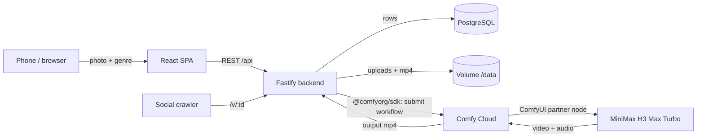

# hypereel 🎬

**Make anything overdramatic.** Upload one photo (your cat, your lunch, your houseplant), pick a genre, and get a 5-second clip with a **narrator voiceover, music and sound effects**, all generated in **one pass** by **MiniMax H3** running as a **ComfyUI workflow on Comfy Cloud**. Every clip gets a share link with a playable preview and a **"Make your own" / "Remix"** button.

Built for the [Open Source Higgsfield](https://comfy.org/open-source-higgsfield/) challenge. #OpenSourceHiggsfield

| Genre | What you get |
|---|---|
| 🎬 Action Trailer | "In a world..." narrator, braaam, lens flares |
| 🌿 Nature Documentary | Whispering British naturalist, birdsong |
| 📺 Infomercial | "But wait, there's more!", cash-register ding |
| 💔 K-Drama | Rain, slow turn, piano ballad, a line in Korean |
| 🕯️ Horror | Flicker, creeping camera, heartbeat |
| 👨‍🍳 Cooking Show | Sizzle, orbit shot, applause |

## How it works



1. The backend normalises the photo (EXIF rotate, ≤1280px JPEG) and builds a genre prompt. Each prompt is a tiny screenplay: camera direction, a narrator line, and music/SFX cues ([prompts.ts](codebase/backend/src/prompts.ts)).
2. It loads the ComfyUI workflow [workflows/hypereel_h3_i2v_api.json](workflows/hypereel_h3_i2v_api.json), binds the photo to `LoadImage` and the prompt to the `MiniMax H3 First-Last-Frame to Video` node, and submits it to Comfy Cloud with the official TypeScript SDK ([comfy.ts](codebase/backend/src/services/comfy.ts)).
3. H3 renders video and stereo audio together (no separate TTS or music model). A 5 s 480P clip takes about 25 s.
4. The result lands in storage; `/v/:id` serves a share page with `og:video` tags so it previews inside iMessage/Discord/X, then sends humans to the app.

**The workflow is a normal ComfyUI workflow.** Open ComfyUI (local or cloud), drag `workflows/hypereel_h3_i2v_api.json` in, and it runs. To change the pipeline (e.g. turn on H3's 2K upscale or prompt-enhance nodes), edit it in ComfyUI, export with *Workflow → Export (API)*, and update node ids in [hypereel_h3_i2v_map.json](workflows/hypereel_h3_i2v_map.json). No code changes needed.

### Tools and models used
- **ComfyUI / Comfy Cloud** runs the workflow. **MiniMax H3 Max Turbo** is the core model, via its ComfyUI partner node.
- **@comfyorg/sdk** submits jobs, streams progress, and downloads outputs.
- Fastify, Prisma + PostgreSQL, React + Vite, sharp. No other AI models.

### Cost
H3 Max Turbo at 480P costs about 7.5 Comfy credits per second, so a 5-second clip is about 38 credits, roughly $0.18. Public deployments are protected by per-session, per-IP and global daily caps (`LIMIT_*` env vars).

## Run it locally

Requirements: Node 22+, a Comfy Cloud account with API access and an API key from [platform.comfy.org](https://platform.comfy.org). Docker is optional.

```bash
git clone https://github.com/HideInSky/hypereel && cd hypereel
cp .env.example .env          # then paste COMFY_API_KEY and set COMFY_MODE=workflow
npm install
npm run db:local -w codebase/backend          # terminal 1: embedded PostgreSQL on :54329 (no Docker needed)
npm run migrate:deploy -w codebase/backend    # apply migrations
npm run dev -w codebase/backend               # terminal 2: API on :3000
npm run dev -w codebase/frontend              # terminal 3: app on http://localhost:5173
```

`COMFY_MODE=fake` (the default) skips Comfy entirely and returns a placeholder video, so you can work on the UI without spending credits. You need to drop any mp4 at `codebase/backend/test/fixtures/sample.mp4` for that mode.

**Try the model without the app:**
```bash
COMFY_MODE=workflow npm run smoke -w codebase/backend -- ~/Pictures/cat.jpg nature "my cat Mochi"
```

### With Docker Compose
```bash
cp .env.example .env
docker compose up --build                 # postgres + backend :3000 + frontend :5173, hot reload
docker compose --profile tunnel up        # also expose it via Cloudflare Tunnel (CLOUDFLARE_TUNNEL_TOKEN)
```
Postgres data lives in the named volume `pgdata`, and generated media in `media`.

## Tests, lint, CI

```bash
npm run lint && npm run typecheck && npm test && npm run build
```
Backend tests boot a throwaway embedded PostgreSQL, apply the real migrations, and exercise the HTTP API with a stubbed video provider. [GitHub Actions](.github/workflows/ci.yml) runs the same steps against a Postgres service container on every push and PR, then builds the production Docker image. On `main` it pushes the image to Docker Hub as `<user>/hypereel:<git-sha>`, but only when `DOCKERHUB_USERNAME`/`DOCKERHUB_TOKEN` secrets are set. CI never deploys.

## Database migrations

The schema lives in [prisma/schema.prisma](codebase/backend/prisma/schema.prisma). Every change becomes a versioned SQL file in `prisma/migrations/`.

```bash
npm run migrate:dev -w codebase/backend -- --name add_something   # dev: create + apply a new migration
npm run migrate:deploy -w codebase/backend                        # prod: apply pending migrations only
```
The production container runs `prisma migrate deploy` before starting. Prisma migrations are forward-only. To revert one, write a new migration that undoes it, and back up the DB (`pg_dump`) before any destructive change.

## Deploy (Railway)

1. Create a Railway project from this GitHub repo. [railway.json](railway.json) tells it to build `codebase/backend/Dockerfile`, which also builds the frontend.
2. Add a **PostgreSQL** service and set `DATABASE_URL=${{Postgres.DATABASE_URL}}` on the app.
3. Add a **volume** mounted at `/data`.
4. Set `COMFY_MODE=workflow`, `COMFY_API_KEY`, `COOKIE_SECRET`, `PUBLIC_URL=https://<your-app>.up.railway.app`, and the optional `LIMIT_*` vars.
5. Railway redeploys on every push to `main`. The health check is `/api/health`.

**Roll back:** in Railway → Deployments, pick the previous deployment → *Redeploy*. Alternatively, `git revert <sha> && git push`. Migrations are not rolled back automatically.

## Roadmap
- **Kubernetes + GitOps:** run the SHA-tagged image on a local Kubernetes cluster with a PostgreSQL StatefulSet. Migrations would run as a pre-sync Job. Argo CD would watch a separate config repo, so deploying means bumping the image tag and rolling back means reverting that commit.
- S3/R2 storage behind the existing `Storage` interface, plus a job queue instead of in-process jobs.
- Optional 2K upscale and H3 prompt-enhance toggles, which are already nodes in the H3 template.

## License
[MIT](LICENSE). Generated clips are subject to the MiniMax/Comfy terms for partner-node outputs.
