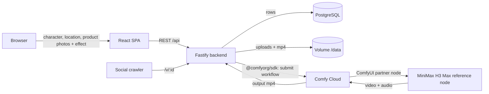

# hypereel

**Open-source viral video effects.** Upload a character (and optionally a location and products), pick an effect, and get a vertical clip with sound. Rendered by **MiniMax H3** running as a **ComfyUI workflow on Comfy Cloud**. Every clip gets a share link that plays inside chat apps.

Built for the [Open Source Higgsfield](https://comfy.org/open-source-higgsfield/) challenge. #OpenSourceHiggsfield

It ships with 45 effects, from Vanish and Floating Fall to Earth Zoom, Melting and Infinite Clones, plus community recipes and a Studio for writing your own. Each is a short recipe in [effects.ts](codebase/backend/src/effects.ts), so adding one takes a few lines. Effects with an example clip have been rendered and checked. The rest are written but not yet rendered, so their results may need tuning.

Render example clips for more effects (each one costs real credits):

```bash
npm run previews -w codebase/backend -- melting earth-zoom
```

## Canvas: assets, characters and stories on one board

Next to Effects there's a Canvas: a free board you can pan and zoom, where everything you make is a card and lines show what was made from what. A user can keep several canvases, each with its own link.

- **Images.** Upload one, or describe it and Nano Banana 2 makes it, optionally from other cards.
- **Characters.** A name and up to 4 photos, or describe an invented person.
- **Character sheets.** One click turns a character into one wide image in three panels: the body from the front with the head left out (so the outfit, build and proportions read clearly), the body from behind, and a tight face close-up looking into the camera. All three sit on flat mid-grey, because a white background brightens the character and a black one darkens it, and the video model carries that over. An invented character's description is written once at the top. From a sheet you can make a **new outfit** (the face and body stay the same) or a **new art style** (anime, 3D animated, pixel art, comic ink, claymation) of the same character. Sheets render at 2K. The template is open: see `sheetPrompt` in [workflows.ts](codebase/backend/src/services/workflows.ts).
- **Videos.** Pick cards as the character, location and products, then an effect or your own prompt. MiniMax H3 renders picture and sound together.
- **Stories.** Any finished video can grow before and after (below), shown left to right on the board, with a story strip for sound and export.

Uploads, moving cards and exporting are free. Anything a model makes costs credits, so it goes through daily caps that are checked under a Postgres lock.

## Assets: a library across canvases

**Assets** sits next to Canvas in the top bar. It keeps the images, characters, character sheets and videos someone wants to reuse:

- **Save** any card from a canvas, or any finished clip, with one click. Saving copies the files, so the library item and the canvas card can each be deleted on their own.
- **Organize** by category (Characters, Places and Props built in, plus your own), mark favorites, rename, and sort by newest, recently used, name or your own drag-and-drop order.
- **Reuse**: on a canvas, "From Assets" opens a picker with Favorites, Recently used and each category; on the Effects page, each upload slot can pick from Assets too.
- **Make more** right in Assets: upload, generate an image or an invented character, make a character sheet, a new outfit or art style from a sheet, or regenerate anything that was made from a prompt.

Like canvases, Assets belong to the browser's signed session: nobody else can see or change them.

## Stories: every clip is the middle of a video

An AI clip is usually a dead end: five seconds, and the next generation is a different person in a different world. In hypereel a finished clip can grow in both directions:

- **Continue** picks up exactly where a clip ends, or leads exactly into where it starts. The shot after a clip begins on that clip's last frame, and the shot before it ends on that clip's first frame, so the join is invisible. A shot before a clip needs an opening frame, so Nano Banana draws one (same person and pose, new place) at the clip's exact size, and H3 animates from it into the clip.
- **Restage** keeps the moves and changes the world: the neighbouring clip goes into H3 as "Video 1", with the character photos and any new people, and the prompt asks for the same moves in a new place, style or light. Joins are cuts, like a music video.
- **Sound for the whole story**, as layers that play at the same time: a clip's original sound (keep it, delete it, copy it, move it), AI music (Sonilo) and AI sound effects (ElevenLabs), and ready-made library sounds. Each layer has its own start, length, volume and loop. Once any layer exists, the shots' own sound is muted, so the soundtrack runs across every cut.
- **Export** joins the shots and mixes the layers into one video with ffmpeg. It costs nothing and takes seconds. Anyone with the link can watch; only the maker can edit.

Every shot is a normal clip underneath, so it goes through the same spending caps and restart recovery. The ComfyUI graphs are built in [workflows.ts](codebase/backend/src/services/workflows.ts), and copies to open in the ComfyUI editor are in [workflows/](workflows) (`hypereel_story_*`).

## Effects are open recipes

Higgsfield's effects are closed: you get what they ship. In hypereel an effect is a small JSON file in an open format, `hypereel-effect/1`, and that one file works everywhere:

- **Write it.** Effect Studio turns an idea into timed beats and shows the exact prompt H3 will read.
- **Remix it.** "Remix" opens any effect, built-in or not, as an editable recipe. Your version gets its own link.
- **Share it.** Send the link, download the JSON, or add it to [`recipes/community`](comfyui-hypereel/recipes/community) with a pull request.
- **Run it in ComfyUI.** The "ComfyUI" button downloads a ready-to-run workflow with your prompt, clip length and image slots filled in. The [`comfyui-hypereel`](comfyui-hypereel) custom node also lists every recipe, so ComfyUI users get the same effects without the website. A parity test makes sure the node and the app write identical prompts.

Saving, sharing and exporting cost nothing. Only rendering uses credits, and it goes through the same caps as any other clip. Custom effects are reachable only by their link, so there's no public feed of user-written text to moderate.

## How it works



1. **Inputs.** A character is required (up to 4 photos). A location (up to 2) and products (up to 3) are optional. That makes at most 9, the limit of the H3 reference node.
2. **Recipe.** Each effect in [effects.ts](codebase/backend/src/effects.ts) is a fixed recipe: a timed motion description, sound cues and a clip length. The recipe changes depending on what was uploaded. For example, Eyes In flies out into your location photo if you gave one.
3. **Prompt.** The backend always attaches images in the order characters, locations, products. The prompt then refers to them by position ("Image 1 and Image 2 show the character"), which is how the node tells them apart. An optional user prompt is appended as extra direction.
4. **Render.** [comfy.ts](codebase/backend/src/services/comfy.ts) loads [the workflow](workflows/hypereel_effects_h3_api.json), creates one `LoadImage` node per upload, and submits it to Comfy Cloud with the official TypeScript SDK. H3 renders picture and stereo audio together. A clip takes about 30 to 60 seconds.
5. **Share.** The result lands in storage, and `/v/:id` serves a page with `og:video` tags so it previews inside chat apps, then sends people to the app.

**The workflow is a normal ComfyUI workflow.** Open ComfyUI (local or cloud), drag `workflows/hypereel_effects_h3_api.json` in, pick images, and it runs. Node ids are mapped in [hypereel_effects_h3_map.json](workflows/hypereel_effects_h3_map.json), so re-exporting needs no code changes.

**Example clips.** The clips in `codebase/frontend/public/effects/` were rendered by this project from invented people and products made with Nano Banana 2. They contain no third-party footage. The gallery opens with a showcase where every effect has its own person, scene and shape: see [render-showcase.ts](codebase/backend/scripts/render-showcase.ts) and [showcase.ts](codebase/backend/src/showcase.ts).

### Tools and models used
- **ComfyUI / Comfy Cloud** runs the workflows. **MiniMax H3 Max** is the core model, via its ComfyUI partner nodes: Reference to Video for effects and Restage, First-Last-Frame to Video for Continue.
- **Sonilo** (music) and **ElevenLabs** (sound effects) partner nodes make story sound on request.
- **Nano Banana 2** (a ComfyUI partner node) draws the opening frame for a Continue shot placed before a clip. It also made the fictional reference images for the example clips.
- **@comfyorg/sdk** submits jobs, streams progress and downloads outputs.
- Fastify, Prisma + PostgreSQL, React + Vite, sharp.

### Cost
H3 Max costs about $0.0715 per second at 480P and $0.114 per second at 768P. Using several reference images can add up to about $0.10 or more.

| Clip | 480P | 768P |
|---|---|---|
| 5 s (Vanish) | $0.36, about 75 credits | $0.57, about 120 credits |
| 8 s (Floating Fall, Eyes In) | $0.57, about 120 credits | $0.92, about 195 credits |

Public deployments are protected by per-session, per-IP and global daily caps (`LIMIT_*` env vars). The global default is 25 clips a day.

### Reliability and limits
- **Spending caps are atomic.** Checking the caps and creating the clip happen under one Postgres lock, so parallel requests can't slip past them.
- **Renders survive restarts.** The Comfy job id is saved as soon as the job exists, and on startup the server re-attaches to unfinished jobs. A render that never reached Comfy is marked failed.
- **API key.** `COMFY_API_KEY` stays on the server and never reaches the browser. Visitors render on the deployer's credits, limited by the `LIMIT_*` caps.
- **Client IP.** `CLIENT_IP_HEADER` names the header your proxy sets, and Railway is detected automatically. `X-Forwarded-For` is never trusted.
- **Privacy.** Only the clip's owner can see the photos, note and error details behind it. Share pages show the video and a generic preview image.
- **Smooth playback.** The model's clips run 6-9 Mbps at 480P. Finished clips are re-encoded to about 1.9 Mbps for the player. Gallery clips are about 0.5-1 Mbps, show a poster at once, start together only after buffering, and pause off-screen. `ffmpeg-static` provides the encoder, so there's nothing to install on the host.
- **Current scaling limit: one instance.** Media lives on a local volume and renders run inside the web process. To scale out, swap `storage.ts` for S3 or R2, and move renders to a queue worker.

## Run it locally

Requirements: Node 22+, a Comfy Cloud account with API access and an API key from [platform.comfy.org](https://platform.comfy.org). Docker is optional.

```bash
git clone https://github.com/HideInSky/hypereel && cd hypereel
cp .env.example .env          # then paste COMFY_API_KEY and set COMFY_MODE=workflow
npm install
npm run db:local -w codebase/backend          # terminal 1: embedded PostgreSQL on :54329 (no Docker needed)
npm run migrate:deploy -w codebase/backend    # apply migrations
npm run dev -w codebase/backend               # terminal 2: API on :3000
npm run dev -w codebase/frontend              # terminal 3: app on http://localhost:5173
```

`COMFY_MODE=fake` (the default) skips Comfy entirely and returns a placeholder video, so you can work on the UI without spending credits. If you put an mp4 at `codebase/backend/test/fixtures/sample.mp4`, effect clips use it; otherwise fake mode makes a 3-second test pattern with ffmpeg.

**Try the model without the app:**
```bash
COMFY_MODE=workflow npm run smoke -w codebase/backend -- vanish character:$HOME/Pictures/me.jpg product:$HOME/Pictures/phone.jpg
```

### With Docker Compose
```bash
cp .env.example .env
docker compose up --build                 # postgres + backend :3000 + frontend :5173, hot reload
docker compose --profile tunnel up        # also expose it via Cloudflare Tunnel (CLOUDFLARE_TUNNEL_TOKEN)
```
Postgres data lives in the named volume `pgdata`, and generated media in `media`.

## Tests, lint, CI

```bash
npm run lint && npm run typecheck && npm test && npm run build
```
The custom node has its own tests: `cd comfyui-hypereel && python3 -m unittest discover -s tests`.

Backend tests boot a throwaway embedded PostgreSQL, apply the real migrations, and exercise the HTTP API with a stubbed video provider. [GitHub Actions](.github/workflows/ci.yml) runs the same steps against a Postgres service container on every push and PR, then builds the production Docker image. On `main` it pushes the image to Docker Hub as `<user>/hypereel:<git-sha>`, but only when `DOCKERHUB_USERNAME`/`DOCKERHUB_TOKEN` secrets are set. CI never deploys.

## Database migrations

The schema lives in [prisma/schema.prisma](codebase/backend/prisma/schema.prisma). Every change becomes a versioned SQL file in `prisma/migrations/`.

```bash
npm run migrate:dev -w codebase/backend -- --name add_something   # dev: create + apply a new migration
npm run migrate:deploy -w codebase/backend                        # prod: apply pending migrations only
```
The production container runs `prisma migrate deploy` before starting. Prisma migrations are forward-only. To revert one, write a new migration that undoes it, and back up the DB (`pg_dump`) before any destructive change.

## Deploy (Railway)

1. Create a Railway project from this GitHub repo. [railway.json](railway.json) tells it to build `codebase/backend/Dockerfile`, which also builds the frontend.
2. Add a **PostgreSQL** service and set `DATABASE_URL=${{Postgres.DATABASE_URL}}` on the app.
3. Add a **volume** mounted at `/data`.
4. Set `COMFY_MODE=workflow`, `COMFY_API_KEY`, `COOKIE_SECRET`, `PUBLIC_URL=https://<your-app>.up.railway.app`, and the optional `LIMIT_*` vars.
5. Railway redeploys on every push to `main`. The health check is `/api/health`.

**Roll back:** in Railway → Deployments, pick the previous deployment → *Redeploy*. Alternatively, `git revert <sha> && git push`. Migrations are not rolled back automatically.

## Roadmap
- **Kubernetes + GitOps:** run the SHA-tagged image on a local Kubernetes cluster with a PostgreSQL StatefulSet. Migrations would run as a pre-sync Job. Argo CD would watch a separate config repo, so deploying means bumping the image tag and rolling back means reverting that commit.
- S3/R2 storage behind the existing `Storage` interface, plus a job queue instead of in-process jobs.
- Optional 2K upscale and H3 prompt-enhance toggles, which are already nodes in the H3 template.

## License
[MIT](LICENSE). Generated clips are subject to the MiniMax/Comfy terms for partner-node outputs.
