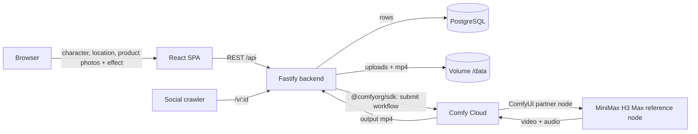

# hypereel

**Open-source viral video effects.** Upload a character (and optionally a location and products), pick an effect, and get a vertical clip with sound. Rendered by **MiniMax H3** running as a **ComfyUI workflow on Comfy Cloud**. Every clip gets a share link that plays inside chat apps.

Built for the [Open Source Higgsfield](https://comfy.org/open-source-higgsfield/) challenge. #OpenSourceHiggsfield

It ships with 45 effects, from Vanish and Floating Fall to Earth Zoom, Melting and Infinite Clones. Each is a short recipe in [effects.ts](codebase/backend/src/effects.ts), so adding one takes a few lines. Effects with an example clip have been rendered and checked. The rest are written but not yet rendered, so their results may need tuning.

Render example clips for more effects (each one costs real credits):

```bash
npm run previews -w codebase/backend -- melting earth-zoom
```

## How it works



1. **Inputs.** A character is required (up to 4 photos). A location (up to 2) and products (up to 3) are optional. That makes at most 9, the limit of the H3 reference node.
2. **Recipe.** Each effect in [effects.ts](codebase/backend/src/effects.ts) is a fixed recipe: a timed motion description, sound cues and a clip length. The recipe changes depending on what was uploaded. For example, Eyes In flies out into your location photo if you gave one.
3. **Prompt.** The backend always attaches images in the order characters, locations, products. The prompt then refers to them by position ("Image 1 and Image 2 show the character"), which is how the node tells them apart. An optional user prompt is appended as extra direction.
4. **Render.** [comfy.ts](codebase/backend/src/services/comfy.ts) loads [the workflow](workflows/hypereel_effects_h3_api.json), creates one `LoadImage` node per upload, and submits it to Comfy Cloud with the official TypeScript SDK. H3 renders picture and stereo audio together. A clip takes about 30 to 60 seconds.
5. **Share.** The result lands in storage, and `/v/:id` serves a page with `og:video` tags so it previews inside chat apps, then sends people to the app.

**The workflow is a normal ComfyUI workflow.** Open ComfyUI (local or cloud), drag `workflows/hypereel_effects_h3_api.json` in, pick images, and it runs. Node ids are mapped in [hypereel_effects_h3_map.json](workflows/hypereel_effects_h3_map.json), so re-exporting needs no code changes.

**Example clips.** The clips in `codebase/frontend/public/effects/` were rendered by this project from invented people and products made with Nano Banana 2. They contain no third-party footage.

### Tools and models used
- **ComfyUI / Comfy Cloud** runs the workflow. **MiniMax H3 Max** is the core model, via its ComfyUI partner node.
- **Nano Banana 2** (a ComfyUI partner node) made the fictional reference images for the example clips only. It is not used at runtime.
- **@comfyorg/sdk** submits jobs, streams progress and downloads outputs.
- Fastify, Prisma + PostgreSQL, React + Vite, sharp.

### Cost
H3 Max costs about $0.0715 per second at 480P and $0.114 per second at 768P. Using several reference images can add up to about $0.10 or more.

| Clip | 480P | 768P |
|---|---|---|
| 5 s (Vanish) | $0.36, about 75 credits | $0.57, about 120 credits |
| 8 s (Floating Fall, Eyes In) | $0.57, about 120 credits | $0.92, about 195 credits |

Public deployments are protected by per-session, per-IP and global daily caps (`LIMIT_*` env vars). The global default is 25 clips a day.

## Run it locally

Requirements: Node 22+, a Comfy Cloud account with API access and an API key from [platform.comfy.org](https://platform.comfy.org). Docker is optional.

```bash
git clone https://github.com/HideInSky/hypereel && cd hypereel
cp .env.example .env          # then paste COMFY_API_KEY and set COMFY_MODE=workflow
npm install
npm run db:local -w codebase/backend          # terminal 1: embedded PostgreSQL on :54329 (no Docker needed)
npm run migrate:deploy -w codebase/backend    # apply migrations
npm run dev -w codebase/backend               # terminal 2: API on :3000
npm run dev -w codebase/frontend              # terminal 3: app on http://localhost:5173
```

`COMFY_MODE=fake` (the default) skips Comfy entirely and returns a placeholder video, so you can work on the UI without spending credits. You need to drop any mp4 at `codebase/backend/test/fixtures/sample.mp4` for that mode.

**Try the model without the app:**
```bash
COMFY_MODE=workflow npm run smoke -w codebase/backend -- vanish character:$HOME/Pictures/me.jpg product:$HOME/Pictures/phone.jpg
```

### With Docker Compose
```bash
cp .env.example .env
docker compose up --build                 # postgres + backend :3000 + frontend :5173, hot reload
docker compose --profile tunnel up        # also expose it via Cloudflare Tunnel (CLOUDFLARE_TUNNEL_TOKEN)
```
Postgres data lives in the named volume `pgdata`, and generated media in `media`.

## Tests, lint, CI

```bash
npm run lint && npm run typecheck && npm test && npm run build
```
Backend tests boot a throwaway embedded PostgreSQL, apply the real migrations, and exercise the HTTP API with a stubbed video provider. [GitHub Actions](.github/workflows/ci.yml) runs the same steps against a Postgres service container on every push and PR, then builds the production Docker image. On `main` it pushes the image to Docker Hub as `<user>/hypereel:<git-sha>`, but only when `DOCKERHUB_USERNAME`/`DOCKERHUB_TOKEN` secrets are set. CI never deploys.

## Database migrations

The schema lives in [prisma/schema.prisma](codebase/backend/prisma/schema.prisma). Every change becomes a versioned SQL file in `prisma/migrations/`.

```bash
npm run migrate:dev -w codebase/backend -- --name add_something   # dev: create + apply a new migration
npm run migrate:deploy -w codebase/backend                        # prod: apply pending migrations only
```
The production container runs `prisma migrate deploy` before starting. Prisma migrations are forward-only. To revert one, write a new migration that undoes it, and back up the DB (`pg_dump`) before any destructive change.

## Deploy (Railway)

1. Create a Railway project from this GitHub repo. [railway.json](railway.json) tells it to build `codebase/backend/Dockerfile`, which also builds the frontend.
2. Add a **PostgreSQL** service and set `DATABASE_URL=${{Postgres.DATABASE_URL}}` on the app.
3. Add a **volume** mounted at `/data`.
4. Set `COMFY_MODE=workflow`, `COMFY_API_KEY`, `COOKIE_SECRET`, `PUBLIC_URL=https://<your-app>.up.railway.app`, and the optional `LIMIT_*` vars.
5. Railway redeploys on every push to `main`. The health check is `/api/health`.

**Roll back:** in Railway → Deployments, pick the previous deployment → *Redeploy*. Alternatively, `git revert <sha> && git push`. Migrations are not rolled back automatically.

## Roadmap
- **Kubernetes + GitOps:** run the SHA-tagged image on a local Kubernetes cluster with a PostgreSQL StatefulSet. Migrations would run as a pre-sync Job. Argo CD would watch a separate config repo, so deploying means bumping the image tag and rolling back means reverting that commit.
- S3/R2 storage behind the existing `Storage` interface, plus a job queue instead of in-process jobs.
- Optional 2K upscale and H3 prompt-enhance toggles, which are already nodes in the H3 template.

## License
[MIT](LICENSE). Generated clips are subject to the MiniMax/Comfy terms for partner-node outputs.
